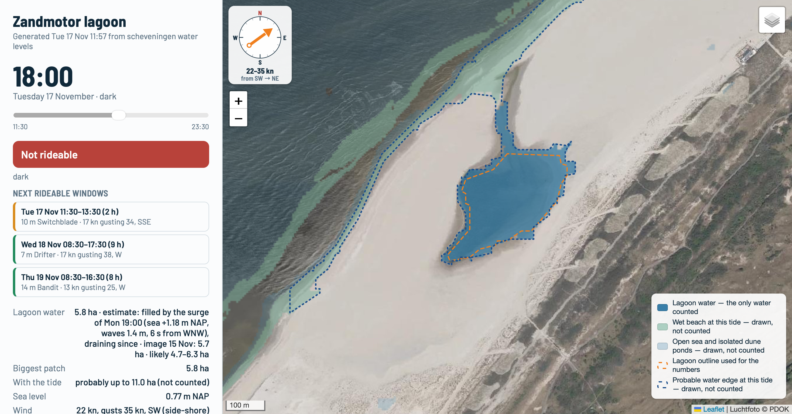

# Zandmotor lagoon

A kitesurfing nowcast for the lagoon on the Zandmotor, the artificial sand peninsula near Kijkduin (The Hague). It builds one self-contained HTML page with a time slider that answers: **is there enough water to ride, does one of my kites fit the wind, and when is the next window?**



> **Not a safety tool.** This is a model estimate. Always check conditions and local kite zones on the spot.

## Install on a Mac (5 minutes)

You don't need to know anything about programming. You need a Mac and an internet connection.

1. Open **Terminal**: press ⌘ and the space bar, type `Terminal`, and press Enter.
2. Copy this line, paste it into the Terminal window, and press Enter:

   ```
   curl -LsSf https://raw.githubusercontent.com/thijskalshoven/Zandmotor/main/install.sh | sh
   ```

   It takes a minute or two. When it says **Done**, a folder called **Zandmotor Kite** opens, and there is a **Zandmotor** icon on your Desktop. You can close Terminal.
3. Double-click **Zandmotor** on your Desktop.
4. The first time, it asks a few questions in a Terminal window: your weight, the strongest gusts you want to ride in, and your kites. For each kite, give its size and, if you know it, the wind range from the maker's chart (for example `11-25`). To add a photo, drag the picture into the window and press Enter. Press Enter without typing anything to skip a question or keep the value shown in [brackets].
5. The report opens in your browser. From then on, double-click **Zandmotor** whenever you want a fresh one.

The first report also downloads the lagoon model (about 10 MB), so it takes a little longer.

### Everyday use

Everything lives in the **Zandmotor Kite** folder in your home folder:

| | |
|---|---|
| **Zandmotor** | builds a new report and opens it |
| **Change settings** | asks the questions again, to change your weight or kites |
| **Update Zandmotor** | installs the newest version; your settings and photos are kept |
| `settings.toml` | your settings, which you can also edit in TextEdit (it explains every line, including a storm kite and the wetsuit table) |
| `Kites` | your kite photos |
| `zandmotor_lagoon.html` | the latest report |

The lagoon model updates by itself: the maintainer publishes a new one after each calibration, and the next report picks it up.

The label under the title says which lagoon model the report uses: **Shared lagoon model** with its publish date, or **No lagoon model** when none could be downloaded. Without a model, no lagoon is drawn and every hour shows *Lagoon unknown*. Wind, tide and kite advice still work.

### If something goes wrong

- **"Zandmotor" can't be opened because it is from an unidentified developer**: right-click the icon, choose **Open**, then **Open** again. macOS remembers this.
- **No internet**: the report needs the wind and tide forecasts, so it can't be built offline. A report you already have still opens; the map needs internet, the numbers don't.
- **A message about settings.toml**: double-click **Change settings** to write the file again.
- **"Zandmotor is already running"**: a report is still being built in another window. Wait for it to finish.
- **Something else**: the Terminal window says what went wrong in one line, and the full details are in `zandmotor.log` in your Zandmotor Kite folder. Send that file when you ask for help.

### Uninstall

In Terminal:

```
uv tool uninstall zandmotor
rm -rf ~/Library/Caches/zandmotor
```

Then drag the **Zandmotor Kite** folder and the Desktop icon to the Bin.

## What the report shows

- **A map** of where there is water, hour by hour. Lagoon water, the only water that counts, is drawn in full colour. The wet beach at the current tide is drawn in a lighter tone and the open sea palest; neither is ever counted.
- **A verdict per hour**: *Looks rideable*, *Rideable, with caveats* or *Not rideable*, with the reasons.
- **The next rideable windows** across the whole week-long wind forecast.
- **Wind** as a compass rose on the map (the arrow points where the wind blows towards), plus speed, gusts and whether it is onshore, side-shore or offshore.
- **Kite advice from your own quiver**: which of your kites fits right now.
- **Tide**: sea level through the day and the next high and low waters, as context. The lagoon does not follow the tide, so it changes no verdict.
- **Water temperature** and which wetsuit to wear.
- **Data sources**: when each input was last pulled, so stale data is visible.

## How it works

| Input | Source | Used for |
|---|---|---|
| Terrain | [AHN](https://www.ahn.nl) elevation via PDOK, with the Rijkswaterstaat 2026 coastal survey on top where it has data | which parts of the beach, the basin and the dunes flood at a given sea level |
| Water level | Rijkswaterstaat (measured, forecast incl. surge, astronomical tide) | drawing the wet beach, and when a surge reaches the lagoon |
| Lagoon | Sentinel-2 and Landsat 8-9 images via [Copernicus Data Space](https://dataspace.copernicus.eu) | the lagoon's outline and size |
| Wind, air temperature, rain, daylight | [Open-Meteo](https://open-meteo.com) forecast | kite advice, dark hours, and rain in the fill model |
| Water temperature, waves | Open-Meteo marine API | wetsuit advice, and when a surge reaches the lagoon |

Depth is not modelled. Kiting needs a surface to ride on, not a particular depth, so the only question is whether a spot is wet.

### The lagoon is treated as a slow-moving lake

The lagoon's bed is underwater and can't be measured from elevation data, so its size comes from satellite images instead. `--calibrate` tests a year of images against the tide and against wind gusts. Neither explains how big the lagoon is. It rests at about 2.5 to 4.5 ha, and twice in 2025-26 it filled to about 13 ha for one to three weeks after a stormy spell.

So the report does not forecast the lagoon from the tide. It shows the **newest reliable satellite image**, with its date and which satellite took it. Images are measured over the whole lagoon basin (see below), so a fill isn't cut off at the outline. A chart shows every image in the record, coloured by sensor and radar track.

Between images the lagoon **fills and drains**. It fills fast when a surge floods the basin, up to what the basin holds at that sea level. It then drains back towards its resting size (the median image of the past 60 days) with a time constant of about a day, so the excess halves every ~17 hours. A later surge can refill it. So the lagoon on the map changes from hour to hour after a surge, and the sidebar labels the size as an estimate.

A surge reaches the basin when the sea level plus a share of the wave height crosses the flood level: overwash is waves running up on top of the sea. Every `--calibrate` refits that share, the drain time and the basin floor. It replays the record from each image to the next with the measured sea level, wave history and rain, using the same steps as the report. It also chooses which terms to keep (wave height or run-up, wave direction, rain) by how well each predicts images it wasn't fitted on, so a term that only fits the past is left out. On the 2025-26 record (37 images) the winner is wave height × the onshore share of the wave direction, with a half-day drain time. It misses unseen images by 0.9 ha on average, against 1.1 ha on still water and 1.7 ha for holding the newest image. Rain fitted the past better but predicted worse, so it isn't used.

Those same misses give the estimate a **likely range**, shown in the sidebar and as a band in the chart. The go/no-go verdict tests the low end of it.

The **Lagoon size over time** chart shows the last weeks and the coming week. Dots are satellite images, hollow where clouds hid part of the basin. A thin line runs from each image to the next: that's the replay the fit was scored on, so the gap where it ends beside the next dot shows how far off the model was. A thick line runs from the newest image on, dashed once it becomes a forecast. Triangles mark surges reaching the basin, and an orange line follows the time slider. Replayed from the 10 Nov 2026 image, the lagoon reaches 14 ha at the 12 Nov surge and is back to 6.0 ha at the 15 Nov image, which saw at least 5.7 ha. Fills after heavy rain without a surge (May 2026) are not modelled; the report only warns that the lagoon may have filled.

A dotted **probable water edge** on the map shows where the water probably reaches at each hour: the lagoon plus the flooded water joined to it, up to 300 m beyond the basin. At a surge it reaches the sea. It moves with the tide and is drawn only, never counted.

Each satellite image only counts the pixels it actually saw. Landsat's water threshold is fitted against Sentinel-2 images of the same days. Radar is no longer used for the lagoon: over this flat, wet, sandy basin it can't tell water from sand (the design notes have the numbers). The design notes in [zandmotor_lagoon.py](zandmotor_lagoon.py) record what was tried, including an earlier wind relationship and a rain relationship that turned out to be false positives.

## For developers and the maintainer

### Install from a checkout

Requires Python 3.9 or later.

```bash
git clone https://github.com/thijskalshoven/Zandmotor.git
cd Zandmotor
python -m venv .venv
source .venv/bin/activate
pip install -e ".[dev,tide]"     # tide = optional utide fallback for the water level
zandmotor --setup                # your rider and kites, written to settings.toml
```

### Two layouts

Where the files live depends on how the code is installed:

| | Git checkout (the maintainer, CI, the tests) | Installed with `install.sh` |
|---|---|---|
| `settings.toml`, `Kites/`, the report | the project root | `~/Zandmotor Kite` |
| `lagoon.geojson`, `lagoon_basin.geojson`, `cache/` | the project root | `~/Library/Caches/zandmotor` |
| Lagoon model | your own `--outline` and `--calibrate` | the shared model, downloaded and kept up to date |

A checkout is a folder with both `.git` and `pyproject.toml` next to the package. `ZANDMOTOR_HOME` moves the settings folder in either layout. An installed copy that runs `--calibrate` or `--outline` itself stops following the shared model, until `zandmotor --shared-model`.

### Usage

```bash
python zandmotor_lagoon.py                      # now + next 8 hours, opens in the browser
python zandmotor_lagoon.py --hours 12 --step 30 # 12 hours in 30-minute steps
python zandmotor_lagoon.py --no-open            # write the page without opening it
python zandmotor_lagoon.py --outline            # re-trace the lagoon outline
python zandmotor_lagoon.py --calibrate          # pull recent satellite images of the lagoon
python zandmotor_lagoon.py --setup              # change your rider and kites
```

`python -m zandmotor` and the installed `zandmotor` command work the same way. The output is `zandmotor_lagoon.html`, a single file, in the settings folder. The numbers work offline; the map needs an internet connection.

A normal run needs no account. It uses the cached lagoon model and fetches tide and wind live. The first run also downloads the terrain, which is then cached.

#### Satellite data (optional)

`--calibrate` and `--outline sentinel` need a free [Copernicus Data Space](https://dataspace.copernicus.eu) account. In its dashboard, create an OAuth client (Sentinel Hub) and set:

```bash
export CDSE_CLIENT_ID=...
export CDSE_CLIENT_SECRET=...
```

Run `--calibrate` every week or two. The report warns when the newest lagoon image is more than 14 days old, and when a stormy or wet spell since that image may have filled the lagoon. A run doesn't always find a newer image, because images that don't show most of the lagoon are skipped.

#### Lagoon outline

`--outline` writes `lagoon.geojson` and a check image, `lagoon_outline_check.png`. It also merges the new outline into `lagoon_basin.geojson`, the largest extent the lagoon has been traced at. The basin only grows, so a trace from a quiet day can't shrink it. Patches with no elevation data that touch it are added too, since they were water when surveyed. Delete it if the Zandmotor reshapes so much that the old basin is wrong. A changed outline or basin needs a new `--calibrate`.

- `sentinel`: traced from a recent cloud-free Sentinel-2 image near high water. Needs the account above.
- `osm`: taken from OpenStreetMap. No account needed, but may be outdated.
- `auto` (default): `sentinel` if credentials are set, otherwise `osm`.

Parts of the traced outline that the elevation data shows are dune (above 3 m NAP) are cut off, and the report says how much. The cut used to sit at 0.5 m NAP, but the lagoon is perched above sea level and that removed real lagoon. If the wrong water body is picked, set `CFG["lagoon_hint"]` to a point inside the lagoon, or draw the outline on [geojson.io](https://geojson.io) and save it as `lagoon.geojson`.


### Publishing the shared lagoon model

Installed copies have no Copernicus account, so they use the maintainer's model. After `--outline` or `--calibrate`, publish it:

```bash
brew install gh && gh auth login   # once
scripts/publish-model.sh
```

This writes a snapshot with `zandmotor --export-model` and uploads it to the `model` pre-release on GitHub. The snapshot holds the outline, the basin, the wetness map, the fitted response and fill-and-drain, the newest flats dry-override, the AHN tile and the coastal DTM. AHN is included even though anyone can download it: the basin is built from its gaps and is part of the wetness map's fingerprint, so a newer AHN would make the shared model unusable. Installed copies look for a new snapshot at most every 6 hours (`model_check_hours`), check every file's checksum, and keep the old model if anything fails. To test a snapshot locally: `zandmotor --shared-model path/to/zandmotor-model.zip`; in a checkout this overwrites your own model files.

Installs come from the `main` branch, so keep `main` working and make bigger changes on a branch.

Your own report (a checkout, or an installed copy that runs its own `--calibrate`) is the **admin view**. Its label says *Admin view* and it has an *Admin* panel with the model's fit and whether users get this model, a different (older) one, or none at all. Users' reports never show that panel. With the same model, both views show the same map and numbers.

### Configuration

Your own settings live in `settings.toml` (written by `zandmotor --setup`, and explained line by line inside it):

- **`[rider]`**: weight, `skill_ceiling_kn` (the strongest gust you want to be out in), and optionally height and board.
- **`[[kite]]`**, one per kite: the size, a photo in `Kites/` and, if known, the manufacturer's wind range for a 75 kg rider (`wind_range_75kg`). Ranges are shifted for your weight and capped at your ceiling. A kite without a chart gets an estimated range, marked **e** in the report. Set `exempt_from_ceiling = true` on a storm kite that only makes sense above your ceiling, and `min_wind_kn` to the mean wind it should start at. The kite is then only considered above that wind, whatever your weight.
- **`min_rideable_ha`**: the smallest connected patch of lagoon water worth riding (default 3 ha). It is tested against the low end of the lagoon's likely range when the size is an estimate between images.
- **`[[wetsuit]]`** and **`[wetsuit_chill]`**: the wetsuit advice.

Without a `settings.toml` the report uses an example rider with two example kites, and says so.

Everything else, the site and model constants, lives in `CFG` in [zandmotor/config.py](zandmotor/config.py). For example:

- **`local_dem`**: a path to your own elevation GeoTIFF, instead of downloading AHN.
- **`coastal_dem`**: a newer survey laid over AHN where it has data; by default the Rijkswaterstaat 2026 coastal DTM at `cache/rws_kust_2026_dtm_2m.tif`. The code doesn't download that file. It travels in the shared model, so `zandmotor --shared-model` brings it back if you clear the cache.

### Project layout

```
zandmotor_lagoon.py      entry point, plus the full design notes
zandmotor/
  cli.py                 argument parsing and run orchestration
  config.py              CFG: every tunable, URL and filename, and the two layouts
  settings.py            settings.toml: the user's rider, kites and wetsuit table
  setup_wizard.py        zandmotor --setup
  model_bundle.py        the shared lagoon model: export, download, install
  launchers/             the double-click .command files install.sh sets up
  flood.py               the flood-mask pipeline
  lagoon_model/          lagoon size model (calibration, fill-and-drain fit, runtime)
  satellite/             Copernicus client, Sentinel-2, Landsat 8-9 and Sentinel-1
  terrain.py tides.py wind.py kiting.py windows.py outline.py rendering.py
  html_report/           the HTML template and page assembly
Kites/                   the maintainer's kite photos
install.sh               the one-line Mac installer
scripts/publish-model.sh publishes the shared lagoon model
tests/                   pytest suite (no network needed)
```

`settings.toml`, `cache/`, `lagoon.geojson`, `lagoon_basin.geojson`, the `*_check.png` images and `zandmotor_lagoon.html` are personal or generated, and not tracked.

### Tests

```bash
pip install -e ".[dev]"
pytest
```

## Data and credits

Terrain: [AHN](https://www.ahn.nl) via PDOK (CC0), and the Rijkswaterstaat 2026 coastal DTM. Water level: Rijkswaterstaat WaterWebservices. Satellite images: Copernicus Sentinel-2 and Sentinel-1 data, and Landsat 8-9 (USGS/NASA), via the [Copernicus Data Space Ecosystem](https://dataspace.copernicus.eu). Weather, waves and sea temperature: [Open-Meteo.com](https://open-meteo.com) (CC BY 4.0). Map: OpenStreetMap contributors and the PDOK aerial photo.
